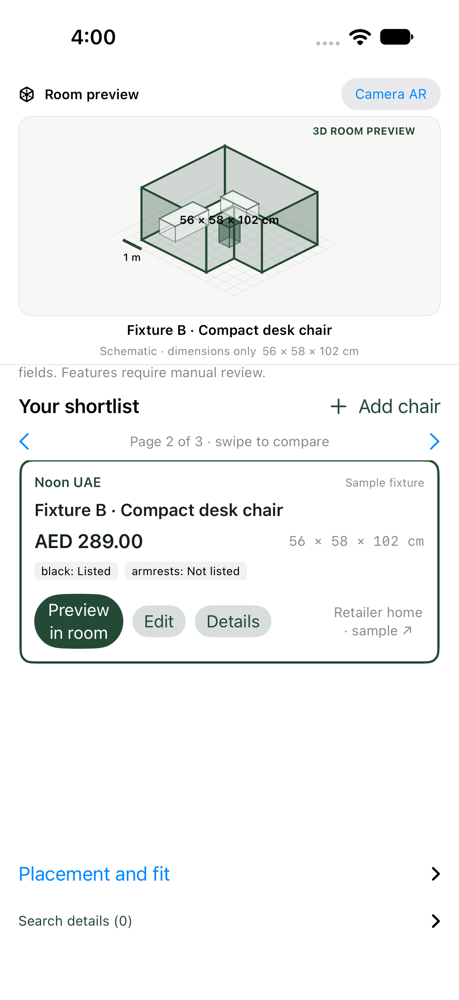
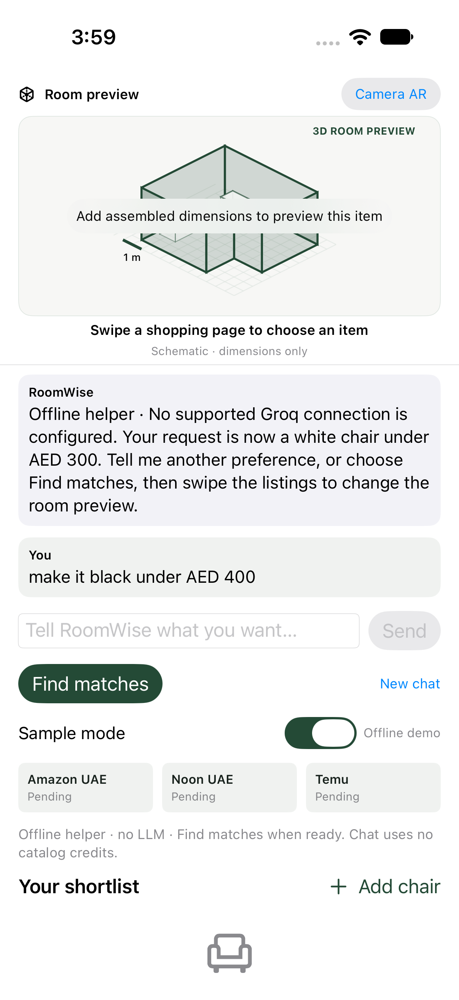
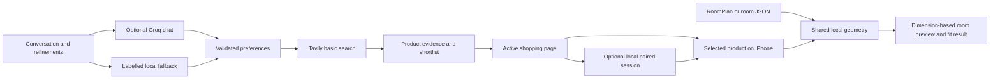

# RoomWise

[](https://github.com/Ansester/RoomWise/actions/workflows/verify.yml)

**Talk about what you want to buy. Browse the options. See each one in your room.**

RoomWise is a conversational furniture-shopping prototype with a live iPhone room preview. Refine a chair request over several messages, swipe through product pages, and the selected chair changes in the room preview. Browse on the phone itself, or pair the desktop companion with a phone over your local network. Shared Kotlin geometry checks the selected chair's floor footprint against captured walls and recognized furniture.

A collaborative software project by [Ashmit Mukherjee](https://github.com/Ansester) and [Aadil Chasmawala](https://github.com/Aarz1401). [Contributor credit](docs/CONTRIBUTORS.md) · [Technical case study](docs/CASE_STUDY.md) · [Documentation index](docs/README.md)

<p>
  
  
</p>

Actual Simulator interaction captures with synthetic sample listings and the labelled offline helper. Groq chat uses your own free-plan key. [Walkthrough](docs/LIVE_SHOPPING.md) · [Verification evidence](docs/VALIDATION.md)

## The shopping loop

1. **Describe what you want.** For example: “A black office chair under AED 500 with armrests.”
2. **Keep talking.** Refine the same request: “Make it white,” “under AED 300 instead,” or “remove the budget.” Press **Send** for a conversational reply and validated preferences, then **Find matches** to retrieve products. A labelled local fallback is available.
3. **Find matches and browse.** Swipe or step through the shortlist's product pages. The active page is the selected product, so selection and preview stay connected. Open its retailer page to inspect the offer.
4. **See the change in your room.** The phone preview uses the selected product's explicit assembled dimensions. A desktop pairing session can drive that same phone selection over trusted local Wi-Fi, without cloud hosting or a RoomWise account.
5. **Check the evidence.** Missing dimensions stay unknown. Add measurements when needed, then move or rotate the preview and inspect the local footprint result.

The current category is **chairs**. The in-room object is a **dimension-based schematic chair**, not the retailer's exact 3D model. Unknown dimensions do not produce an invented size. Browsing refers to RoomWise's retrieved product pages and explicit retailer links; the app does not observe arbitrary tabs in another browser or automatically identify every item on a retailer website. [Detailed workflow and pairing](docs/LIVE_SHOPPING.md).

## What is included

| Capability | Implementation |
| --- | --- |
| Ongoing shopping conversation | Bounded multi-turn Groq chat, validated preferences, explicit local fallback |
| Product-page browsing | Selection-bound shortlist pages and retailer links |
| Live phone preview | Local selection changes; optional desktop-to-phone LAN session |
| Room capture/import | Apple RoomPlan on supported hardware, or validated RoomWise JSON |
| Spatial checks | Rotated floor footprints, room-boundary containment, recognized-object overlap |
| Retailer discovery | Tavily basic search across Amazon UAE, Noon UAE, and Temu |
| Account-free demonstration | Synthetic sample room/chairs, local conversation fallback, preview, fit checks, and LAN pairing |
| Evidence and control | Product provenance, unknown facts, manual dimensions, local deletion, consent, Keychain keys |

RoomWise is a public-source prototype, not an App Store release or an evaluated consumer product. A footprint result does not cover hidden obstacles, chair movement, overhead clearance, door swings, or delivery routes. [Evidence and limits](docs/CLAIMS.md).

## Quick start

### iPhone interface and Simulator

Use an **Apple silicon Mac**, Xcode with an installed iOS Simulator runtime, **JDK 21**, and **Python 3**. The app supports iOS 17 or later; supplied Kotlin/Native simulator targets are ARM64.

1. Clone the repository and open `iosApp/FitCheck.xcodeproj`.
2. Select the shared **FitCheck** scheme and an iPhone Simulator, then Run.
3. Explore the sample room, continue a shopping conversation, and swipe between sample products. This needs no API keys, physical phone, or App Store enrollment.
4. For live discovery, configure personal free-tier keys in Connections. For another-screen browsing, follow [desktop pairing](docs/LIVE_SHOPPING.md).

RoomPlan scanning requires a LiDAR-capable iPhone. Camera AR requires supported hardware and camera permission; Simulator shows a labelled 3D rehearsal. The hosted LLM has no Apple Intelligence requirement. Physical-device installation uses your own Xcode signing configuration.

### Desktop companion

The recorded desktop build/test environment is macOS Apple silicon with JDK 21 and Python 3:

```sh
git clone https://github.com/Ansester/RoomWise.git
cd RoomWise
sh scripts/run-desktop.sh
```

The launcher builds a standalone JAR with provider keys removed from the build process and defaults to sample mode. Explore the sample room, use the conversation and product browser, then explicitly start a phone-pairing session when wanted. No server subscription or hosted backend is required. [Developer setup](docs/DEVELOPMENT.md).

## Free-provider setup

Each user supplies personal credentials; the repository ships no shared key.

1. Create a **Groq Free** account and generate a [Groq API key](https://console.groq.com/keys). The supported `openai/gpt-oss-20b` model is hosted by Groq; this workflow does not call the OpenAI API. Check [current limits](https://console.groq.com/docs/rate-limits).
2. Create a **Tavily Researcher / Free** account and obtain a key. Check [current free allowances](https://www.tavily.com/pricing); the documented plan provides 1,000 monthly credits without a credit card.
3. Enter the keys in Connections, choose live shopping, and permit the disclosed provider sharing. Keep the provider accounts on their free plans for a zero-cost setup.

**Send** uses at most one Groq call per conversation turn, bounded history, no automatic retry, and no paid-provider fallback. **Find matches** sends a nonempty draft once before searching; with no draft, it searches from accepted preferences without a model call. Retailer retrieval uses basic Tavily search and locally parsed snippets, without advanced search or extra page-extraction requests. On iPhone, each catalog search reserves three requests against a local 300-request UTC-month allowance. Chat and browsing are separate from that catalog allowance: changing pages and LAN synchronization do not make provider calls. Desktop has bounded searches but no persisted monthly counter. Provider quotas and account settings still apply. [Full pipeline](docs/SHOPPING_PIPELINE.md).

A Groq failure uses a clearly labelled limited local conversation fallback. Without available Tavily access, sample products, retailer links, and manual entry remain available. Free hosted providers may change their plans or availability; RoomWise does not create subscriptions or upgrade them.

## Architecture



SwiftUI/RoomPlan/ARKit provide the phone interface; Compose provides the desktop interface. The optional desktop HTTP session sends only product/selection state over the local network. Groq receives bounded conversation text and preferences, not room geometry, catalog excerpts, camera images, or fit results. [Architecture](docs/ARCHITECTURE.md) · [Live-shopping protocol](docs/LIVE_SHOPPING.md) · [Privacy](docs/PRIVACY.md).

## Verify and develop

```sh
sh scripts/check.sh                # shared + desktop regression tests
sh scripts/check-ios.sh            # unsigned device compile + simulator tests
sh scripts/check-live-pairing.sh   # real JVM host ↔ native Simulator HTTP client
sh scripts/release-check.sh        # release resources and current-source checks
python3 scripts/check-public-source.py

# Optional unsigned local Release archive. Never uploads or publishes.
sh scripts/archive-ios.sh --unsigned
```

The [validation record](docs/VALIDATION.md) identifies the exact tested revision, completed checks, and their limits. The separate live-pairing check requires macOS/Xcode/JDK 21 and tests the real local transport without provider accounts or physical hardware; it is not a live-retailer or camera test. Provider regression tests use HTTP mocks; they do not establish authenticated-provider reliability, retailer coverage, physical AR accuracy, or user benefit. Public CI results are recorded separately. Standard public-repository CI uses no API secrets and skips private repositories.

The main directories are `iosApp/` (phone UI, capture, AR, chat, pairing, storage), `shared/` (Kotlin models/geometry/evidence), `desktop/` (Compose, chat, shopping, local pairing host), and `scripts/` (build/test/release helpers). [Development](docs/DEVELOPMENT.md) · [Contributing](CONTRIBUTING.md).

## Documentation and portfolio

Start with [live shopping and pairing](docs/LIVE_SHOPPING.md), the [user guide](docs/USER_GUIDE.md), or the [demo walkthrough](docs/DEMO.md). For a technical review, read the [case study](docs/CASE_STUDY.md), [architecture](docs/ARCHITECTURE.md), and [claim ledger](docs/CLAIMS.md).

[Prepared CV and website copy](docs/PORTFOLIO.md) describes the collaborative conversational-shopping prototype with measured engineering evidence. Actual CV/website publication remains separate. [Future App Store materials](docs/APP_STORE.md) and local support/privacy pages under `docs/store-site/` are prepared assets, not a deployed app or website.

## Public-source scope

This repository starts from a reviewed source snapshot with contributor credit. Earlier private history, local keys, generated credentials, build outputs, and private device data are excluded. See [public-release notes](docs/PUBLIC_RELEASE_CHECKLIST.md).

Use `config.example.properties` only as a template for ignored desktop configuration. iPhone keys are entered in Connections; no iPhone configuration embeds local-file credentials. Never commit keys, pairing URLs, or private room files. [Security reporting](SECURITY.md).

No project LICENSE file is included. See [contributor and licensing notes](docs/CONTRIBUTORS.md) before reuse. Support: **info.roomwise@gmail.com**.
