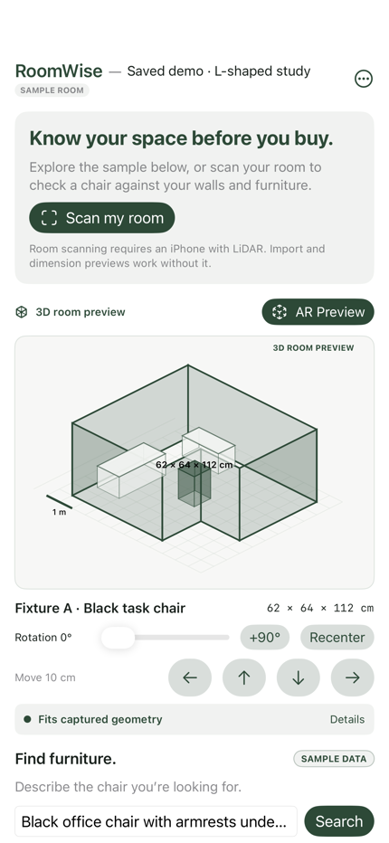
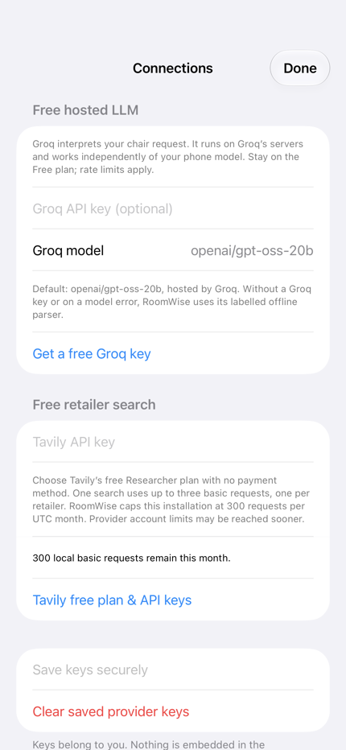
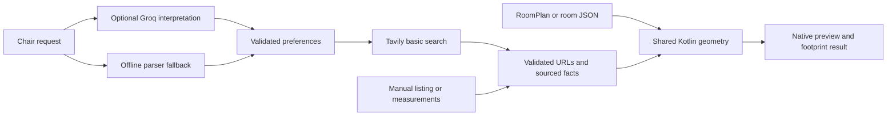

# RoomWise

**Chair fit checks for a captured room — with native iPhone and desktop interfaces.**

RoomWise combines room capture, a scaled chair preview, and shared Kotlin geometry to help compare furniture dimensions with a space before buying. Optional Groq and Tavily integrations interpret shopping requests and find retailer listings. Product measurements and geometric fit come from explicit evidence and deterministic code.

A collaborative software prototype by [Ashmit Mukherjee](https://github.com/Ansester) and [Aadil Chasmawala](https://github.com/Aarz1401). [Contributor credit](docs/CONTRIBUTORS.md) · [Technical case study](docs/CASE_STUDY.md) · [Documentation index](docs/README.md)

<p>
  
  
</p>

Hosted iPhone renders. The room and chairs shown are labelled synthetic samples.

## What it does

| Task | Implementation |
| --- | --- |
| Capture or import a room | Native Apple RoomPlan on supported hardware, or validated RoomWise JSON |
| Inspect the space | Scaled room projection and a simplified AR chair preview |
| Check placement | Rotated floor footprints, room-boundary containment, and recognized-object overlap |
| Find chairs | Hosted Groq request interpretation and Tavily basic search across Amazon UAE, Noon UAE, and Temu |
| Work without provider accounts | Sample room/chairs, local fit checks, dimension editing, manual chair entry, and retailer search links |
| Track uncertainty | Separate sample/live/saved/user-entered provenance; missing or conflicting facts remain unknown |
| Control local data | Room export, provider-sharing consent/revocation, saved-data deletion, and separate key clearing |

The app is a prototype with reproducible engineering checks. It has not been published to the App Store or evaluated for user outcomes. A geometric result concerns the captured floor footprint: hidden obstacles, movement, overhead clearance, door swings, and delivery routes are outside its checks.

## Quick start

### iPhone interface and Simulator

Use an **Apple silicon Mac**, Xcode with an installed iOS Simulator runtime, **JDK 21**, and **Python 3**. The app supports iOS 17 or later; supplied Kotlin/Native simulator targets are ARM64.

1. Clone this repository and open `iosApp/FitCheck.xcodeproj`.
2. Select the shared **FitCheck** scheme and an iPhone Simulator.
3. Run. Xcode builds the shared Kotlin framework through the checked-in Gradle wrapper.
4. Explore the sample room, select a chair, edit its assembled dimensions, and move/rotate/recenter it. This workflow needs no API keys, physical phone, or App Store enrollment.

RoomPlan scanning requires a LiDAR-capable iPhone. Real camera AR requires supported hardware and camera permission; Simulator shows a labelled 3D rehearsal. The hosted LLM has no Apple Intelligence or device-specific model requirement. Installing on physical hardware uses your own Xcode signing configuration.

### Desktop companion

The documented desktop workflow is verified on macOS Apple silicon with JDK 21 and Python 3:

```sh
git clone https://github.com/Ansester/RoomWise.git
cd RoomWise
sh scripts/run-desktop.sh
```

The launcher builds a standalone JAR with provider keys removed from the build process, then defaults to offline sample mode. Optional `local` or `groq` modes use your own provider accounts. See [setup and troubleshooting](docs/DEVELOPMENT.md) for prerequisites, configuration, platform limits, and direct Gradle use.

## Optional free-tier shopping

1. Create a **Groq Free** account and generate your own [API key](https://console.groq.com/keys). The default `openai/gpt-oss-20b` model is hosted by Groq; the current app path does not call the OpenAI API. [Free-plan policy](https://community.groq.com/t/do-i-get-charged-for-anything-on-the-groq-free-plan/832), [current model limits](https://console.groq.com/docs/rate-limits).
2. Create a **Tavily Researcher / Free** account and obtain its key. Its [current free plan](https://www.tavily.com/pricing) provides 1,000 monthly credits with no credit card. Keep free plans without paid upgrades if you want a zero-cost setup.
3. On iPhone, open **Room actions → Connections**, save personal keys, turn off **Sample mode**, and permit the disclosed provider sharing. Desktop users select live mode and enter keys in the launcher or Connections.

Each user supplies their own credentials. There is no shared developer key or server to deploy. Groq interprets chair requirements; Tavily finds indexed retailer pages. This is web discovery of product listings, not exhaustive Amazon catalog access.

On iPhone, a search uses at most one Groq request and three Tavily basic requests. Requests are reserved against a local 300-request UTC-month allowance before dispatch, with no retries, advanced-search escalation, remote page extraction, or paid-provider fallback. Missing Groq access uses a labelled offline parser. Missing Tavily access or exhausted quota leaves retailer browsing and manual entry available. Desktop uses a bounded Koog requirements phase and basic search; it does not currently implement the iPhone monthly allowance. [Full pipeline and platform differences](docs/SHOPPING_PIPELINE.md).

## Architecture



SwiftUI/RoomPlan/ARKit provide the iPhone interface; Compose provides the desktop interface. Both use shared Kotlin room and geometry contracts. Provider requests contain chair requirements, not room coordinates or camera images. [Architecture](docs/ARCHITECTURE.md) · [Geometry](docs/GEOMETRY.md) · [Room format](docs/ROOM_FORMAT.md) · [Privacy](docs/PRIVACY.md).

## Verify and develop

```sh
sh scripts/check.sh                # shared + desktop regression tests
sh scripts/check-ios.sh            # unsigned device compile + simulator XCTest
sh scripts/release-check.sh        # release resources and current-source checks
python3 scripts/check-public-source.py

# Optional unsigned local Release archive. Never uploads or publishes.
sh scripts/archive-ios.sh --unsigned
```

The [validation record](docs/VALIDATION.md) contains actual local test/build results and their limits. Live provider tests use HTTP mocks; they do not establish authenticated endpoint reliability, catalog coverage, physical scanning accuracy, or user benefit. Public GitHub Actions results are reported separately from local verification. Standard public-repository CI is configured without API secrets; the workflow skips private repositories.

The main directories are `iosApp/` (SwiftUI, capture, AR, storage, and shopping), `shared/` (Kotlin models, geometry, and evidence extraction), `desktop/` (Compose and Koog), and `scripts/` (launch/build/test tools). [Developer guide](docs/DEVELOPMENT.md) · [Contributing](CONTRIBUTING.md).

## Documentation and portfolio

Start with the [user guide](docs/USER_GUIDE.md) or [three-minute walkthrough](docs/DEMO.md). For an implementation review, read the [case study](docs/CASE_STUDY.md), [architecture](docs/ARCHITECTURE.md), and [claim-to-evidence ledger](docs/CLAIMS.md).

[CV bullets and website copy](docs/PORTFOLIO.md) are prepared for featuring the project with collaborative attribution and measured engineering evidence. They do not claim deployment, real-world accuracy, adoption, or sole authorship. [Optional future App Store materials](docs/APP_STORE.md) and local support/privacy pages under `docs/store-site/` are prepared assets, not a deployed app or website.

## Public-source scope

This public repository starts from a reviewed source snapshot with contributor credit. Earlier private development history, ignored local keys, generated secrets, build outputs, and device data are excluded. The historical private repository is preserved separately. See [public-release notes](docs/PUBLIC_RELEASE_CHECKLIST.md) for the inspection scope and remaining credential-owner responsibilities.

Use `config.example.properties` only as a template for ignored desktop runtime configuration. iPhone users enter keys in Connections; no iPhone build configuration embeds local file credentials. Never commit keys or private room files. [Security reporting](SECURITY.md).

No project LICENSE file is included. See the [contributor and licensing notes](docs/CONTRIBUTORS.md) before reuse. Support: **info.roomwise@gmail.com**.
