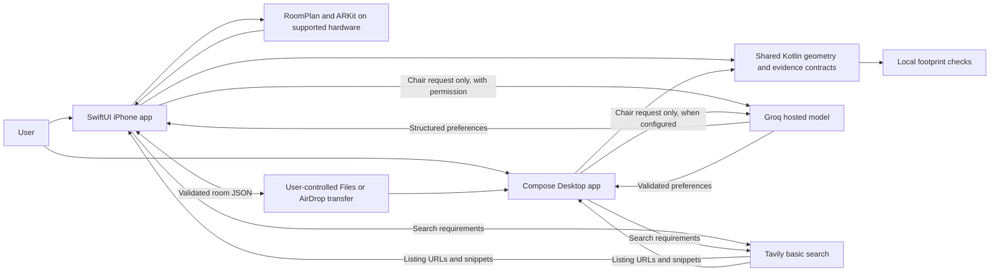
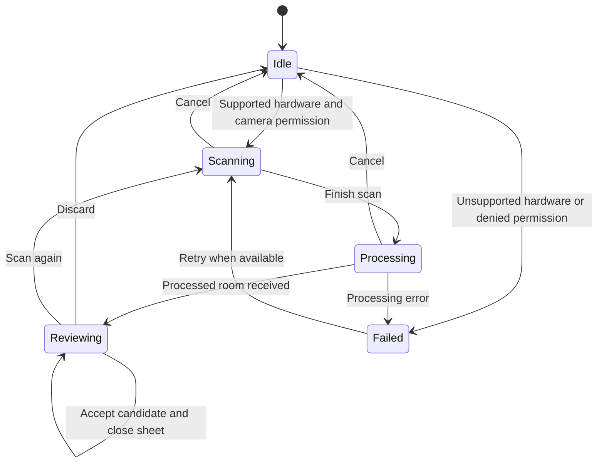

# Architecture

RoomWise keeps spatial decisions in a shared deterministic core and uses hosted language models only to interpret shopping requirements. The repository contains two native frontends, not a website or a developer-operated cloud backend. The sample workflow runs without provider accounts or the author's hardware.

## Components and responsibilities

| Component | Responsibilities | Main source |
| --- | --- | --- |
| Shared Kotlin module | Serializable room/product contracts, geometry, scan quality, placement, product evidence, retailer URL rules | [`shared/src/commonMain/kotlin/fitcheck`](../shared/src/commonMain/kotlin/fitcheck) |
| iPhone frontend | SwiftUI workspace, RoomPlan capture, ARKit/SceneKit previews, Files import/export, local session storage, Keychain, free-tier shopping orchestration | [`iosApp`](../iosApp) |
| Desktop frontend | Compose workspace, room import, comparison UI, coroutine-based retailer retrieval, optional Koog/Groq requirements interpretation | [`desktop/src/main/kotlin/fitcheck`](../desktop/src/main/kotlin/fitcheck) |
| Build/verification tooling | Gradle wrapper, native-framework build phase, unsigned compilation, XCTest, release-resource checks, optional archive | [`scripts`](../scripts) |
| Optional external services | Groq interprets the chair request; Tavily finds indexed retailer product pages | [Shopping pipeline](SHOPPING_PIPELINE.md) |

Provider keys authenticate requests to their respective services. Room coordinates, camera images, room summaries, product excerpts, and fit-tool outputs are not included in the current hosted LLM context. On iPhone, external sharing requires the app's explicit Groq/Tavily consent. On desktop, the user configures live provider mode through Connections or the launcher; the desktop does not implement the iPhone consent dialog.

## Shared core and platform boundary

The `shared` Gradle module targets JVM, `macosArm64`, `iosArm64`, and `iosSimulatorArm64`. The desktop consumes its JVM output. Xcode's build phase links an appropriate Kotlin/Native static framework named `FitCheckShared`; Swift consumes Kotlin-exported classes and functions.

`Models.kt` defines immutable Kotlin data classes for `Room`, `RoomElement`, `Pose`, `Dimensions`, `Product`, and `Preferences`. Both frontends therefore use the same coordinate conventions, source-evidence structure, and core placement calculations. Native presentation remains platform-specific: SwiftUI and ARKit are not shared with Compose.

`RoomBridge` provides a small defensive serialization boundary for Swift. Its validation/decode methods return an empty string or `nil` on failure rather than allowing malformed imported JSON to terminate the Swift UI. Exported rooms are validated through the same Kotlin decoder used on desktop import. The [room format](ROOM_FORMAT.md) is the interchange contract; [geometry](GEOMETRY.md) explains its mathematical interpretation.

## iPhone state and capture lifecycle

`ContentView` coordinates the accepted room, chair list, selected chair, placement, sample/live mode, retailer statuses, and the current search task. The accepted room is independent of an in-progress scan. A cancelled or rejected scan therefore does not replace the working room.

`RoomCaptureController` represents capture as `idle`, `scanning`, `processing`, `reviewing`, or `failed`. Each `ScanSession` has a unique ID and its own `RoomCaptureView` delegate. Cancellation detaches the delegate and stops the session. Callbacks verify that the session is still active, preventing delayed camera permissions or processing callbacks from replacing newer state. A 15-second processing timer exposes recovery controls; it is not a promised processing deadline.

The drawing is a dimensionally scaled projection of captured geometry. AR renders a simplified chair with the selected dimensions and places it using a horizontal-plane raycast. It does not reconstruct a retailer's exact chair mesh or automatically align the imported room's coordinate origin with the current AR session.

## Persistence and data ownership

| Data | iPhone | Desktop |
| --- | --- | --- |
| Accepted room, last query, products, selected ID, pose, statuses, sample mode | App `UserDefaults`; OS backup may include it | Workspace state held in Compose memory; imported room file remains under user control |
| Groq/Tavily keys | Entered in Connections; device Keychain | Session memory, environment, or an explicitly supplied ignored local properties file |
| Local retailer request allowance | Separate `UserDefaults` record keyed by UTC month | No persisted equivalent in the current desktop implementation |
| Shared room file | User-initiated JSON export to temporary share file | User-selected JSON import |

When iPhone products are restored, `LIVE` becomes `SAVED_LIVE`; fixtures remain fixtures and `USER_ENTERED` remains user-entered. Unknown or corrupt saved content falls back safely. Deleting planning data clears saved room/search state and the temporary export, revokes consent in the UI, and leaves the separate usage allowance intact. Clearing provider keys is a separate explicit action.

## Asynchronous boundaries

The iPhone search task has an active request UUID. Starting, cancelling, switching modes, or changing relevant room state invalidates old work; callbacks only update the UI for the active request. Backgrounding cancels current searches and preserves the local session. `FreeCatalogSearch` runs on the main actor for atomic local quota reservation and serialized state callbacks, while URLSession performs asynchronous networking.

Desktop uses coroutines, a bounded Koog requirements phase, and local `ShoppingTools` caches. Only `GroqPreferenceTools.set_preferences` is exposed to the hosted agent. Product search and fit tools exist locally and are completed deterministically after language interpretation, so the model cannot silently omit a retailer or supply its own geometry result.

## Reading and extending the source

Start with [`Models.kt`](../shared/src/commonMain/kotlin/fitcheck/Models.kt), [`Geometry.kt`](../shared/src/commonMain/kotlin/fitcheck/Geometry.kt), [`FreeShopping.swift`](../iosApp/FreeShopping.swift), and [`Agent.kt`](../desktop/src/main/kotlin/fitcheck/Agent.kt). See [development](DEVELOPMENT.md) for build details and extension points. The retained `ShoppingAgent.swift` is legacy compatibility/tested code; the current iPhone `ContentView` routes automatic shopping through `FreeShoppingParser` and `FreeCatalogSearch`.

The [validation record](VALIDATION.md) distinguishes automated evidence from hardware and live-service verification. The architecture is implemented source behavior, not evidence of deployment, user-study outcomes, or guaranteed real-world fit.
