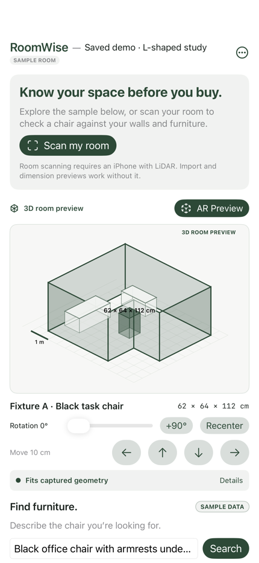

# RoomWise: connecting furniture evidence to room geometry

**Status:** collaborative software prototype

**Contributors:** [Ashmit Mukherjee and Aadil Chasmawala](CONTRIBUTORS.md)

**Repository:** https://github.com/Ansester/RoomWise

**Stack:** Kotlin Multiplatform, SwiftUI, RoomPlan, ARKit/SceneKit, Compose Desktop, Groq, Tavily

RoomWise checks a chair's floor footprint against captured room boundaries and recognized furniture. A native iPhone interface handles room capture and camera-based placement; a desktop companion imports the same room contract. Shared Kotlin code owns geometry and product-evidence rules.

Hosted iPhone render with synthetic sample geometry and chair data. It demonstrates the implemented interface, not a live catalog result or a physical scanning evaluation.

## The engineering problem

A furniture fit check joins two imperfect inputs. Room capture may miss walls or objects. A shopping listing may show package size, omit assembled dimensions, contain conflicting prices, or refer to a different variant. A language model can help interpret a request, but it cannot establish the room geometry or invent a missing measurement.

The implementation therefore treats request interpretation, product evidence, and spatial calculation as separate stages. Each stage has its own validation and failure behavior. The resulting interface can show a useful preview while still withholding a fit conclusion when the required evidence is absent.

This is an engineering motivation reflected in the code. It is not a finding from a user study or evidence that RoomWise improves purchasing outcomes.

## A shared contract with native frontends

The [room model](../shared/src/commonMain/kotlin/fitcheck/Models.kt) defines dimensions, positions, yaw, captured elements, and a versioned JSON format. Coordinates use metres and a right-handed Y-up, floor-XZ convention. The captured world origin and original transforms are retained rather than assuming every room is an axis-aligned rectangle.

The [iPhone capture controller](../iosApp/RoomCaptureController.swift) manages RoomPlan's scan, processing, review, cancellation, and error phases. Exported geometry passes through the shared validation path. The [desktop application](../desktop/src/main/kotlin/fitcheck/App.kt) imports that contract and renders a room and candidate placement with Compose.

The shared layer avoids duplicating the central geometry and evidence rules in two frontends. The UI remains platform-specific so iPhone can use native capture, camera permissions, Keychain, and ARKit.

## Fit is a deterministic footprint calculation

The geometry layer transforms all four corners of the candidate rectangle by its position and yaw. It checks those corners and the rectangle's edges against the floor polygon, including concave intrusions that a corner-only test can miss. Furniture overlap uses separating axes from both rotated rectangles; touching recognized furniture is treated conservatively as an overlap.

Boundary reconstruction joins captured wall endpoints only when the connection is unambiguous within the configured 3 cm tolerance. Gaps, branching connections, degenerate loops, and self-intersections do not become a confirmed room boundary. A partial room can still be visualized, but boundary fit is withheld.

Initial placement first tries the room's centre and nearby positions. A bounded whole-room grid provides a fallback for concave rooms where the bounding-box centre is outside the usable floor. This finds a candidate when the tested locations permit one; it is not an optimization or a proof that all possible placements were searched.

These mechanisms are implemented in [Geometry.kt](../shared/src/commonMain/kotlin/fitcheck/Geometry.kt) and exercised in [CoreTest.kt](../shared/src/commonTest/kotlin/fitcheck/CoreTest.kt). A fit result concerns captured floor geometry. It does not check hidden obstacles, furniture motion, overhead clearance, door swing, or delivery routes.

## AI interprets requirements; it does not supply measurements

The default iPhone shopping path sends the chair request to hosted Groq using a constrained JSON schema. The output is validated as preferences such as budget, colour, required features, and maximum size. The LLM receives no room coordinates and does not generate product dimensions, prices, or a fit verdict. The desktop Groq tool surface is restricted to recording preferences; retailer and room tools remain local.

Tavily basic search then discovers indexed product pages from the supported retailer domains. Listing URLs are checked against retailer and product-path rules. Product fields are extracted conservatively from the returned evidence. Package dimensions cannot stand in for assembled dimensions, and multiple conflicting values remain unknown. Users can enter their own measurements or paste listing details, with that provenance retained.

The iPhone path makes at most one Groq call and three basic retailer-search requests per search. Its per-install allowance reserves all three Tavily calls before dispatch, counts failures and cancellation against that reservation, and uses a 300-request UTC-month cap. That local counter is separate from provider account quotas and external billing choices. Missing keys or exhausted search access leave direct retailer browsing and manual entry available.

See [the pipeline implementation](../iosApp/FreeShopping.swift), [product extraction](../shared/src/commonMain/kotlin/fitcheck/ProductExtraction.kt), and the [shopping pipeline guide](SHOPPING_PIPELINE.md). Discovery is indexed web search, not exhaustive Amazon catalog access or verified live stock.

## Failure states are part of the product

RoomWise explicitly distinguishes synthetic examples, live search evidence, saved live evidence, and user-entered information. Restoring a session preserves those distinctions, including an empty prior search. Request identifiers and task cancellation keep stale callbacks from replacing a newer search state.

The iPhone interface exposes import errors, incomplete room boundaries, missing dimensions, retailer failures, and provider limits. Sample mode is available without network accounts. The user can revoke provider sharing, delete locally saved planning data, and clear keys through the separate credential controls. The [privacy policy](PRIVACY.md) describes those data flows and their limits.

These are specific implementation choices rather than a general claim of complete security, privacy, or error freedom.

## Verification and what remains unknown

The [local validation record](VALIDATION.md) documents **67 passing automated tests** across shared geometry, desktop shopping, desktop UI smoke checks, and iOS XCTest. It also records an unsigned iPhone build and Release archive, source/resource checks, and ten hosted interface renders. Representative screenshots were visually inspected.

Provider tests use HTTP mocks, which make quota, cancellation, malformed-data, and request-boundary behavior reproducible without using credentials or credits. They do not establish authenticated live-service reliability. Hosted renders establish a bounded view of the interface, not complete touch-navigation, camera, or AR testing. Current physical-device behavior and user outcomes were not reverified in that release work.

There are no recorded measurements of user adoption, reduced furniture returns, time savings, real-world fit accuracy, or improved purchase confidence. The source release makes the engineering work inspectable; it does not turn those unmeasured outcomes into results.

## What a reviewer can inspect

- [Architecture](ARCHITECTURE.md): module and service boundaries.
- [Geometry](GEOMETRY.md): coordinate conventions, containment, collisions, and limits.
- [Shopping pipeline](SHOPPING_PIPELINE.md): requirements, retrieval, evidence, quotas, and fallback behavior.
- [User guide](USER_GUIDE.md) and [development guide](DEVELOPMENT.md): running and extending a clone.
- [Claims guide](CLAIMS.md): wording suitable for a portfolio, CV, or presentation.
- [Contributor record](CONTRIBUTORS.md): collaborative attribution across the public source snapshot.
