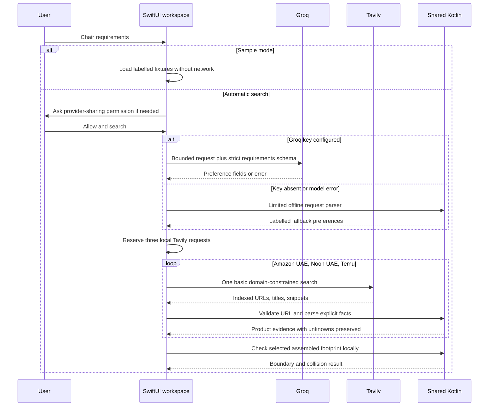

# Shopping pipeline and evidence

RoomWise separates three decisions: interpreting a request, retrieving retailer evidence, and checking geometry. A hosted model performs the first task. Explicit source text and shared Kotlin rules perform the second. Local geometry performs the third. The model does not generate product dimensions, prices, retailer links, or fit results.

The iPhone entry point is `ContentView.performSearch` → [`FreeShoppingParser`](../iosApp/FreeShopping.swift) → `FreeCatalogSearch`. Desktop uses [`ShoppingSession`](../desktop/src/main/kotlin/fitcheck/Shopping.kt) and a restricted Koog/Groq preference tool. Both ultimately use [`ProductExtraction.kt`](../shared/src/commonMain/kotlin/fitcheck/ProductExtraction.kt).

## End-to-end iPhone request

A missing Tavily key prevents automatic retrieval. The iPhone then offers Connections, direct retailer search links, and manual chair entry. A missing Groq key does not prevent Tavily search; it selects the limited offline parser. Browser search links only navigate when tapped and contain a URL-encoded version of the user's query.

## Hosted LLM boundary

The default model ID is `openai/gpt-oss-20b`, served by **Groq**, at `https://api.groq.com/openai/v1/chat/completions`. The `openai/` prefix identifies a model family and the wire format is OpenAI-compatible; neither means this path calls the paid OpenAI API. The model ID is pinned in the current free workflow. An unsupported custom ID selects/reaches local fallback rather than an implicit provider switch.

On iPhone, the request is capped at 1,500 characters for interpretation. The response uses a strict JSON schema with nullable budget, currency, colour, width/depth limits, and an array of required features. Local validation still runs after decoding. Limits include a positive finite budget up to 1,000,000, width/depth limits up to 10 m, supported currency codes `AED`, `USD`, `EUR`, `GBP`, at most ten required features, and bounded text lengths. An unstated currency defaults to AED; no currency conversion occurs.

Only the chair request is sent to Groq. The current hosted context has no room geometry, room counts, product snippets, placement results, or retailer-search tools. On desktop, `GroqPreferenceTools` exposes only `set_preferences`; the broader `ShoppingTools` methods remain local. Product and geometry outputs therefore cannot become remote tool observations through that restricted registry.

The iPhone sends at most one Groq request per search, with no automatic retry. Missing keys, malformed/invalid output, unavailable models, network errors, or quota errors produce an explicitly labelled offline fallback. Cancellation propagates rather than starting fallback work after the user cancelled.

## Offline parser

The shared parser is intentionally small. It recognizes a limited set of budget phrases, colour keywords, armrest requests, and a comfort preference. It does not claim general natural-language understanding, reliable multilingual parsing, or subjective comfort verification. Its label and notes remain visible in search details. Inspect the interpreted requirements and retailer page when a request is complex.

Sample mode is separate from offline interpretation: sample mode returns synthetic fixtures without contacting either provider. Offline interpretation can still be used to prepare a real Tavily search when a Tavily key is configured.

## Tavily retrieval and quota boundaries

Automatic discovery searches indexed pages on Amazon UAE (`amazon.ae`), Noon UAE (`noon.com`), and Temu (`temu.com`). It is not a direct retailer catalog API, Amazon Associates integration, or exhaustive product inventory.

The current basic-search path uses `search_depth = basic`, `auto_parameters = false`, no generated answer, and no raw page content. It parses returned snippets locally; it does not spend extra requests on Tavily `/extract`. iPhone search queries also include a `site:` restriction, while returned links independently pass the shared retailer validator. Domain preferences from a search engine are never sufficient by themselves to establish a product listing.

| Behavior | iPhone | Desktop |
| --- | --- | --- |
| Hosted interpretation | One Groq request maximum | Koog requirements agent, at most two iterations |
| Product retrieval | One basic request per retailer, sequential | One cached basic search per retailer in a shopping session; deterministic completion uses coroutines |
| Candidate limit | Up to two accepted listings per retailer | Up to two accepted listings per retailer |
| Full-page extraction | Not used by current free path | `extract` reads the already-returned snippet locally |
| Persistent local allowance | 300 basic requests per installation per UTC month | No equivalent persistent monthly allowance implemented |
| Quota/key failures | Terminal key/quota statuses stop remaining retailer dispatches | Store failures are isolated and reported; successful store results are retained |
| Credentials | Connections/Keychain | Session memory, environment, or ignored local config |

On iPhone, three requests are reserved atomically before the first retailer request. Cancellations and failed calls keep their reservations, so repeated cancellation cannot recycle the local allowance. Deleting saved rooms/searches does not reset it. The allowance rolls over by UTC calendar month and is per installation, not an authoritative account balance. A provider key used elsewhere can exhaust its free quota sooner.

Choose the providers' free plans if the goal is a zero-cost setup. RoomWise does not create subscriptions or upgrade accounts, but it cannot determine or override billing choices made in those external accounts. Current plans and models should be checked in the providers' own [Groq limits](https://console.groq.com/docs/rate-limits) and [Tavily pricing](https://www.tavily.com/pricing) pages; free service availability is not a permanent repository guarantee.

## Listing validation

`Retailer.accepts` requires HTTPS and the intended retailer domain or its subdomains, then checks the path shape:

- Amazon UAE: a `/dp/` or `/gp/product/` path with a ten-character alphanumeric product identifier.
- Noon UAE: the `/uae-en/` region and a listing `/p` path segment.
- Temu: a goods-style path recognized by the current rule.

Whitespace, control characters, backslashes, unsupported hosts, homepages, and search pages are not accepted as live product links. URL validation constrains source identity; it does not establish that a page is reachable, that a seller is trustworthy, or that its content is correct.

The iPhone additionally filters common chair-accessory titles, retains the exact accepted URL, and derives stable listing IDs from a URL hash. The current desktop title filter is simpler. These filters can reject relevant items or miss some unsuitable results; search-result coverage has not been evaluated as a recall/precision benchmark.

## Conservative fact extraction

Shared extraction keeps ambiguous values unknown:

- Prices require explicit `AED` evidence. Multiple distinct AED prices withhold the selected price. Other currency prices are not converted into AED.
- Size requires a single unambiguous assembled/product/overall-dimension line with labelled width, depth, and height and supported units. Package/carton/shipping dimensions are excluded.
- Supported units are metres, centimetres, millimetres, and inches. All stored dimensions normalize to metres.
- Colour/armrest evidence uses explicit labels. Unsupported features and subjective comfort stay unknown unless the implemented rule has suitable evidence.
- Seller, model, availability, and delivery strings use constrained explicit labels when present.

Preferences guide retrieval; they do not guarantee every search hit satisfies the request. Missing prices or evidence cannot establish budget compliance. A “lowest price” label is limited to comparable known prices in the current results, not a market-wide claim or proof that two listings are the same variant.

Manual chair entry accepts a name, optional accepted retailer URL, optional pasted source text, and optional assembled measurements. Pasted text is processed locally. All such entries carry `USER_ENTERED` provenance, including facts parsed from user-pasted text. Editing a retrieved chair's measurements records user-origin dimension evidence rather than turning the measurement into independently retrieved retailer evidence.

## Provenance and lifecycle

`FIXTURE` means a synthetic sample. `LIVE` means a retrieved result in the current session. `SAVED_LIVE` means a previously retrieved iPhone result restored from local persistence. `USER_ENTERED` means supplied by a person. These are evidence-origin labels, not verification certificates.

The iPhone request UUID and cancellation guards prevent earlier searches from updating a later session. Search details identify the parser and requirements. Retailer status messages distinguish empty results, key/quota errors, and partial availability. Existing user-entered chairs can remain in the shortlist while live results change.

## Verification limits

Automated provider tests use injected HTTP responses. They cover endpoint/model/schema selection, bounded calls, quotas, cancellation, URL restrictions, source matching, and provenance. They do not establish that the providers currently accept a particular account key, that live search returns useful chairs, or that retailer snippets are complete. See [validation](VALIDATION.md) for the current evidence and [development](DEVELOPMENT.md) for safe extension points.
