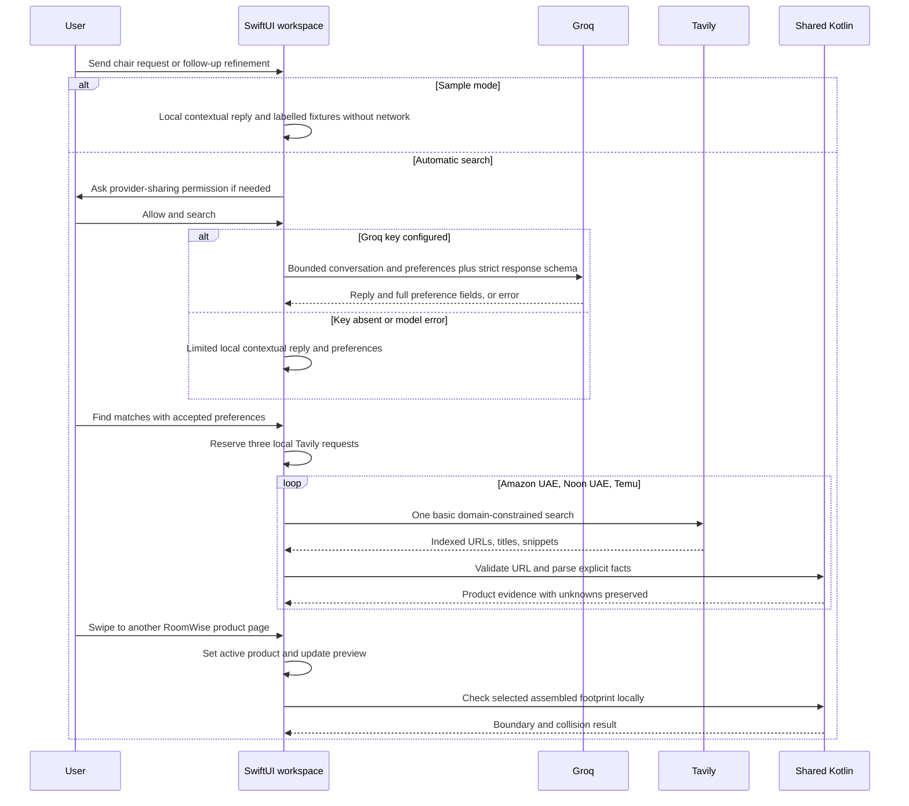

# Shopping pipeline and evidence

RoomWise connects ongoing conversation, product-page browsing, and a changing room preview while keeping three decisions separate: refining shopping intent, retrieving retailer evidence, and checking geometry. A hosted model replies to the conversation and performs the first task. Explicit source text and shared Kotlin rules perform the second. Local geometry performs the third. The model does not generate product dimensions, prices, retailer links, or fit results.

The current conversation services are [`ShoppingConversation.swift`](../iosApp/ShoppingConversation.swift) and [`Conversation.kt`](../desktop/src/main/kotlin/fitcheck/Conversation.kt). Each turn returns a reply plus validated preferences. Catalog discovery then uses `FreeCatalogSearch` on iPhone and local `ShoppingTools` on desktop, with shared [`ProductExtraction.kt`](../shared/src/commonMain/kotlin/fitcheck/ProductExtraction.kt). The older one-shot `FreeShoppingParser`, `ShoppingSession`, and Koog adapter remain compatibility code; they do not define the new conversation UI.

## End-to-end shopping turn

A missing Tavily key prevents automatic retrieval. The iPhone then offers Connections, direct retailer search links, and manual chair entry. A missing Groq key does not prevent Tavily search; it selects the labelled limited local conversation fallback. Fallback browser search links only navigate when tapped and contain a URL-encoded search constructed from accepted preferences; an unsent fragment does not replace the full shopping context.

## Hosted LLM boundary

The default model ID is `openai/gpt-oss-20b`, served by **Groq**, at `https://api.groq.com/openai/v1/chat/completions`. The `openai/` prefix identifies a model family and the wire format is OpenAI-compatible; neither means this path calls the paid OpenAI API. The model ID is pinned in the current free workflow. An unsupported custom ID selects/reaches local fallback rather than an implicit provider switch.

Each turn includes at most twelve recent messages, each bounded to 1,500 characters, plus current structured preferences. **Send** updates the conversation only; **Find matches** sends any nonempty draft once first; with no draft, it retrieves from accepted preferences without a model call. A strict JSON response contains a conversational reply and the complete current preferences. A follow-up can override or remove a prior constraint; the current preference record avoids treating every new message as an unrelated search.

Local validation still runs after decoding. Preference fields include nullable budget, currency, colour, maximum width/depth, and required features. Sizes use metres; supported currencies are `AED`, `USD`, `EUR`, and `GBP`; currency conversion is not performed. Out-of-range or malformed values do not become trusted requirements. See the conversation services and their tests for exact field bounds.

Only bounded conversation and shopping preferences are sent to Groq. The context contains no room geometry, room counts, product snippets, placement results, or catalog/geometry tools. A reply may discuss the request, but it does not supply product facts or certify fit. Retailer retrieval and geometry run locally after interpretation.

At most one Groq request is made per conversational turn, with no automatic retry. Missing keys, malformed/invalid output, unavailable models, network errors, or quota errors produce an explicitly labelled local fallback. Cancellation propagates rather than starting fallback work after cancellation.

## Local conversation fallback and samples

The fallback is a limited deterministic parser that combines the previous preferences with common explicit refinements, such as a replacement colour/budget, removing a budget, or an armrest preference. It is not an offline LLM and does not offer unrestricted language understanding or verified comfort recommendations. Inspect the interpreted preferences when wording is complex, comparative, or ambiguous.

Sample mode uses the local conversation path and synthetic fixtures without contacting either provider. It is separate from local interpretation in live mode: the latter can still prepare a Tavily search when a personal Tavily key is configured. Starting a new chat clears conversation context rather than silently applying the previous request's constraints.

## Browsing and live selection

Each RoomWise product page is a view of an accepted listing or a user-entered product. Changing pages changes selected-product state, which feeds the phone preview and local footprint check. No Groq or Tavily request is made for a page change. Explicit retailer website visits are separate from structured retrieval; navigating an arbitrary retailer page does not automatically create validated product evidence.

With optional desktop pairing, products and the selected ID are published in revisioned local snapshots. The phone applies newer state and can send a known product-ID selection back. Room data, chat, and provider keys remain outside that session. Paired selection updates do not clear phone chat; a phone **Find matches** action disconnects pairing before its local search takes ownership. This uses a temporary trusted-LAN HTTP listener, not a paid relay or cloud deployment. [Workflow, protocol, and transport limits](LIVE_SHOPPING.md).

## Tavily retrieval and quota boundaries

Automatic discovery searches indexed pages on Amazon UAE (`amazon.ae`), Noon UAE (`noon.com`), and Temu (`temu.com`). It is not a direct retailer catalog API, Amazon Associates integration, or exhaustive product inventory.

The current basic-search path uses `search_depth = basic`, `auto_parameters = false`, no generated answer, and no raw page content. It parses returned snippets locally; it does not spend extra requests on Tavily `/extract`. iPhone search queries also include a `site:` restriction, while returned links independently pass the shared retailer validator. Domain preferences from a search engine are never sufficient by themselves to establish a product listing.

| Behavior | iPhone | Desktop |
| --- | --- | --- |
| Hosted conversation | One Groq request maximum per turn | One Groq request maximum per turn |
| Product retrieval | One basic request per retailer, sequential | One cached basic search per retailer in a shopping session; deterministic completion uses coroutines |
| Candidate limit | Up to two accepted listings per retailer | Up to two accepted listings per retailer |
| Full-page extraction | Not used by current free path | `extract` reads the already-returned snippet locally |
| Persistent local allowance | 300 basic requests per installation per UTC month | No equivalent persistent monthly allowance implemented |
| Quota/key failures | Terminal key/quota statuses stop remaining retailer dispatches | Store failures are isolated and reported; successful store results are retained |
| Credentials | Connections/Keychain | Session memory, environment, or ignored local config |

On iPhone, three requests are reserved atomically before the first retailer request. Cancellations and failed calls keep their reservations, so repeated cancellation cannot recycle the local allowance. Deleting saved rooms/searches does not reset it. The allowance rolls over by UTC calendar month and is per installation, not an authoritative account balance. A provider key used elsewhere can exhaust its free quota sooner.

Choose the providers' free plans if the goal is a zero-cost setup. RoomWise does not create subscriptions or upgrade accounts, but it cannot determine or override billing choices made in those external accounts. Current plans and models should be checked in the providers' own [Groq limits](https://console.groq.com/docs/rate-limits) and [Tavily pricing](https://www.tavily.com/pricing) pages; free service availability is not a permanent repository guarantee.

## Listing validation

`Retailer.accepts` requires HTTPS and the intended retailer domain or its subdomains, then checks the path shape:

- Amazon UAE: a `/dp/` or `/gp/product/` path with a ten-character alphanumeric product identifier.
- Noon UAE: the `/uae-en/` region and a listing `/p` path segment.
- Temu: a goods-style path recognized by the current rule.

Whitespace, control characters, backslashes, unsupported hosts, homepages, and search pages are not accepted as live product links. URL validation constrains source identity; it does not establish that a page is reachable, that a seller is trustworthy, or that its content is correct.

The iPhone additionally filters common chair-accessory titles, retains the exact accepted URL, and derives stable listing IDs from a URL hash. The current desktop title filter is simpler. These filters can reject relevant items or miss some unsuitable results; search-result coverage has not been evaluated as a recall/precision benchmark.

## Conservative fact extraction

Shared extraction keeps ambiguous values unknown:

- Prices require explicit `AED` evidence. Multiple distinct AED prices withhold the selected price. Other currency prices are not converted into AED.
- Size requires a single unambiguous assembled/product/overall-dimension line with labelled width, depth, and height and supported units. Package/carton/shipping dimensions are excluded.
- Supported units are metres, centimetres, millimetres, and inches. All stored dimensions normalize to metres.
- Colour/armrest evidence uses explicit labels. Unsupported features and subjective comfort stay unknown unless the implemented rule has suitable evidence.
- Seller, model, availability, and delivery strings use constrained explicit labels when present.

Preferences guide retrieval; they do not guarantee every search hit satisfies the request. Missing prices or evidence cannot establish budget compliance. A “lowest price” label is limited to comparable known prices in the current results, not a market-wide claim or proof that two listings are the same variant.

Manual chair entry accepts a name, optional accepted retailer URL, optional pasted source text, and optional assembled measurements. Pasted text is processed locally. All such entries carry `USER_ENTERED` provenance, including facts parsed from user-pasted text. Editing a retrieved chair's measurements records user-origin dimension evidence rather than turning the measurement into independently retrieved retailer evidence.

## Provenance and lifecycle

`FIXTURE` means a synthetic sample. `LIVE` means a retrieved result in the current session. `SAVED_LIVE` means a previously retrieved iPhone result restored from local persistence. `USER_ENTERED` means supplied by a person. These are evidence-origin labels, not verification certificates.

The iPhone request UUID and cancellation guards prevent earlier turns/searches from updating a later session. Conversation state and search details identify the active engine and requirements. Retailer status messages distinguish empty results, key/quota errors, and partial availability. Existing user-entered chairs can remain in the shortlist while live results change.

## Verification limits

Automated provider tests use injected HTTP responses. They cover endpoint/model/schema selection, bounded calls, quotas, cancellation, URL restrictions, source matching, and provenance. They do not establish that the providers currently accept a particular account key, that live search returns useful chairs, or that retailer snippets are complete. See [validation](VALIDATION.md) for the current evidence and [development](DEVELOPMENT.md) for safe extension points.
